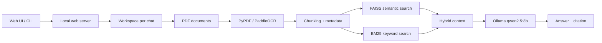

# Paperwise

<div align="center">

**A local PDF assistant that answers from your documents and keeps your files private.**

[](https://www.python.org/)
[](https://ollama.com/)
[](https://ollama.com/library/qwen2.5)
[](https://github.com/facebookresearch/faiss)
[](https://en.wikipedia.org/wiki/Okapi_BM25)
[](#privacy)
[](#tests)

</div>

Paperwise is a local PDF question-answering application for studying, exam preparation, and internal knowledge lookup. Import documents, choose which pages to index, build the index once, and then chat with the selected content.

Your PDFs do not need to be uploaded to the cloud. After the models are downloaded, questions can be answered locally with Ollama.

## Features

- **Local web UI** at `127.0.0.1:8000`, with a streamlined chat interface.
- **PDF import from the browser**, without manually copying files into a data folder.
- **Scoped indexing** by start page and page count, or across the entire document.
- **Build progress and time estimates** while documents are being indexed.
- **Hybrid retrieval** combining FAISS semantic search with BM25 keyword search.
- **File and page citations** to help verify answers.
- **Long-answer mode** that expands context for requests such as “explain the entire question 6.”
- **Separate workspace per conversation**: documents, indexes, and chat history are isolated.
- **Data management**: delete individual PDFs, all documents and indexes, or the current chat history.
- **Scanned-PDF OCR** with PaddleOCR, processing one page at a time to reduce peak memory usage.
- **REPL CLI** for asking questions directly from a terminal.

## Demo workflow

```text
Open the web UI → Import a PDF → Choose pages → Build the index → Ask a question
```

> The first build may take a while because it can run OCR, generate embeddings, and download models. Once indexing is complete, subsequent questions do not require OCR again.

## Requirements

- Windows 10/11 recommended.
- Python 3.11 or later.
- At least 8 GB RAM; 16 GB is recommended for large scanned PDFs.
- Ollama running locally.
- Poppler if OCR is needed for scanned PDFs on Windows.
- Internet access is needed only to install packages and download models for the first time.

## Quick start

### 1. Create and activate a Python environment

```powershell
python -m venv venv
.\venv\Scripts\Activate.ps1
```

If PowerShell blocks script execution in the current session:

```powershell
Set-ExecutionPolicy -Scope Process -ExecutionPolicy RemoteSigned
.\venv\Scripts\Activate.ps1
```

### 2. Install dependencies

```powershell
python -m pip install -r setup.txt
```

### 3. Install and prepare Ollama

Install Ollama from [ollama.com/download/windows](https://ollama.com/download/windows), then open Ollama or run:

```powershell
ollama serve
ollama pull qwen2.5:3b
```

Check that the model is available:

```powershell
ollama list
```

The default model is configured in [config.py](config.py). You can choose a different model without editing the code:

```powershell
$env:OLLAMA_MODEL="qwen2.5:7b"
```

## Run Paperwise

```powershell
.\venv\Scripts\Activate.ps1
python app.py
```

Open this address in your browser:

```text
http://127.0.0.1:8000
```

Keep the server terminal open while using the application.

## Use the web UI

1. Select **New chat** to create a clean workspace.
2. Select **Import PDF** to add one or more PDFs.
3. Set the **Start page** and **Page count**, or select **Index the entire document**.
4. Select **Build index**.
5. Wait for the build to finish before asking questions.
6. Select an existing chat in the sidebar to revisit its history.
7. Delete an individual file with the `×` button, or select **Delete all documents** to remove the current chat's PDFs and index.

Each conversation has its own workspace:

```text
workspaces/<chat_id>/
├── documents/                 # PDFs for this chat
├── vectorstores/db_faiss/     # FAISS, BM25, and manifest
└── history.jsonl              # Chat history for this chat
```

## Run the CLI

Start the interactive REPL:

```powershell
python qabot.py
```

Ask one question and exit:

```powershell
python qabot.py --question "Explain all parts of question 6"
```

Available REPL commands:

```text
/help       Show available commands
/clear      Clear the current chat history
/sources    Show the index and history paths
/reload     Reload the bot
exit        Exit
```

## Build from the terminal

Build the first 10 pages as a quick check:

```powershell
python build_index.py --start-page 1 --page-count 10
```

Build 20 pages starting at page 11:

```powershell
python build_index.py --start-page 11 --page-count 20
```

Build the entire document:

```powershell
python build_index.py --start-page 1 --page-count 0
```

The default OCR language is English. Change it to Vietnamese when appropriate for the document:

```powershell
python build_index.py --start-page 1 --page-count 10 --ocr-lang vi
```

## Architecture overview



### Main components

| Component | Responsibility |
|---|---|
| `app.py` | Entry point for the local web UI |
| `web_server.py` | Upload, chat, build, history, and workspace API |
| `ui/` | HTML, CSS, and JavaScript for the interface |
| `build_index.py` | Build FAISS/BM25 indexes for a selected page range |
| `ingestion/` | PDF loading, OCR, chunking, metadata, and indexing |
| `qabot.py` | Retrieval, grounded prompts, and Ollama answers |
| `workspaces/` | Data isolated by conversation |
| `prepare_model/` | Prepare embedding and Ollama models |

## Privacy

- Imported PDFs are stored locally in each workspace.
- Questions are sent to local Ollama, not a cloud API.
- User data is not committed: `documents/`, `workspaces/`, `vectorstores/`, and model files are ignored by Git.
- The first model/package download requires internet access; offline use may be possible afterward, depending on the environment.

## Tests

Run the tests:

```powershell
.\venv\Scripts\python.exe -m unittest discover -s tests
```

Expected result:

```text
Ran 3 tests ... OK
```

Check Python syntax:

```powershell
.\venv\Scripts\python.exe -m py_compile app.py web_server.py build_index.py qabot.py
```

## Troubleshooting

### Port 8000 is already in use

Stop the old Python server process and restart the application in the virtual environment:

```powershell
Get-CimInstance Win32_Process |
  Where-Object { $_.CommandLine -match 'app\.py' } |
  ForEach-Object { Stop-Process -Id $_.ProcessId -Force }

.\venv\Scripts\Activate.ps1
python app.py
```

### Chat remains locked after importing a PDF

Select **Build index** and wait for the build to finish. Importing a file stores the PDF but does not create an index.

### Answers omit sections from a long question

Use phrases such as `explain the entire section`, `list all parts`, or `give a detailed answer`. Paperwise expands the context to include neighboring chunks. The `qwen2.5:3b` model generally handles long answers better than `qwen2.5:1.5b`, but requires more RAM.

### OCR error or MemoryError

Try indexing fewer pages first:

```powershell
python build_index.py --start-page 1 --page-count 1
```

OCR can take time on large scanned PDFs. Do not close the server while a build is in progress.

### FAISS reports a deserialization error

The application loads its local index with:

```python
FAISS.load_local(path, embedding, allow_dangerous_deserialization=True)
```

Only load indexes created by the application in the local workspace.

## Suggested commit messages

```text
feat: build local PDF chat workspaces with import and scoped indexing
```

Or, more briefly:

```text
feat: add local Paperwise PDF chat UI
```

## License

Distributed under the [MIT License](LICENSE). You may use, copy, modify, and distribute the project under the terms of the license.
